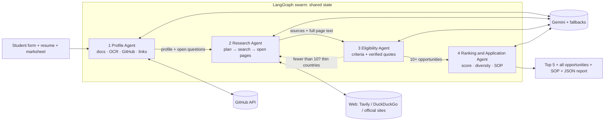

# Architecture and submission notes

## Diagram

## Agent contract

| Agent | Input | Output | Failure behaviour |
|---|---|---|---|
| Profile | form, document text/images, GitHub URL, public links | profile, skills, projects, missing info, sources used | GitHub/link failure logged; AI failure → rule-based extraction |
| Research | profile, previous queries, Eligibility feedback | deduplicated sources with classification and full page text | per-query/page failures isolated; page → snippet fallback; provider fallback |
| Eligibility | profile, sources | opportunities: criteria with quotes, funding, deadline, status, confidence | unverifiable claims downgraded; failed source skipped; triggers broaden loop |
| Ranking & Application | opportunities, profile | top 5 with score breakdown, action items, SOP + warnings | SOP template if AI is down |

## Trust design

1. Every opportunity URL is the page the agents opened. The model cannot supply a URL.
2. Funding, deadline and every met/not-met verdict need a quote that is **found in the page text**; otherwise they are shown as unconfirmed.
3. Status is **computed** from verified criteria (`Likely eligible` needs 2+ criteria, all verified met).
4. Web text is wrapped as untrusted data in prompts (prompt-injection hygiene).
5. Expired deadlines are penalised; study-level mismatches are penalised; score breakdown is visible.

## Interesting experiment (fill in with your own results)

*Hypothesis:* explicit evidence verification changes results more than a better model. Run the same swarm on Rahul and Ananya, and with quote verification on vs. off (comment out the `q_ok` downgrade in `_finalise`). Record: how many opportunities lose "Likely eligible", how many funding/deadline claims become "unconfirmed", and how the top 5 differ per student. **Add your measured numbers here before submitting.**

## Biggest technical challenge (edit to match your experience)

Scholarship facts are time-sensitive, pages are messy, and an LLM will happily produce plausible-sounding deadlines. The solution was to make the model *quote* its evidence and to verify those quotes mechanically against the retrieved page, so trust comes from the pipeline rather than from the model. Second challenge: rate limits and flaky sites, solved with retries, model fallback, provider fallback and a feedback loop between agents.

## 5-minute demo script

1. (0:00) Show Rahul's profile and sample marksheet + resume, press launch.
2. (0:30) Narrate the live cards: Profile reads GitHub → Research plans and opens pages.
3. (1:30) Point at a 🔁 recovery event (e.g. page blocked → snippet fallback, or "only 7/10, broadening").
4. (2:15) All opportunities table → open one source page; show the requirement table with verified quotes.
5. (3:15) Top 5, score breakdown, action items.
6. (4:00) SOP draft with placeholders and number warning; download JSON.
7. (4:30) Switch to Ananya, re-run: same code, different countries and results.
